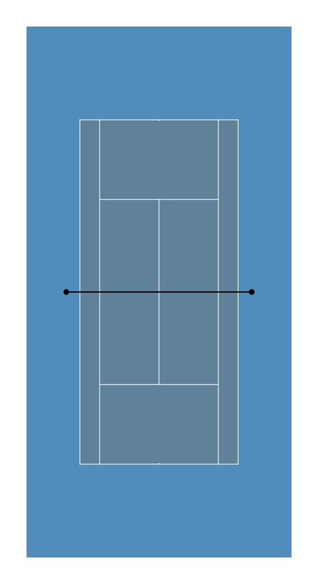
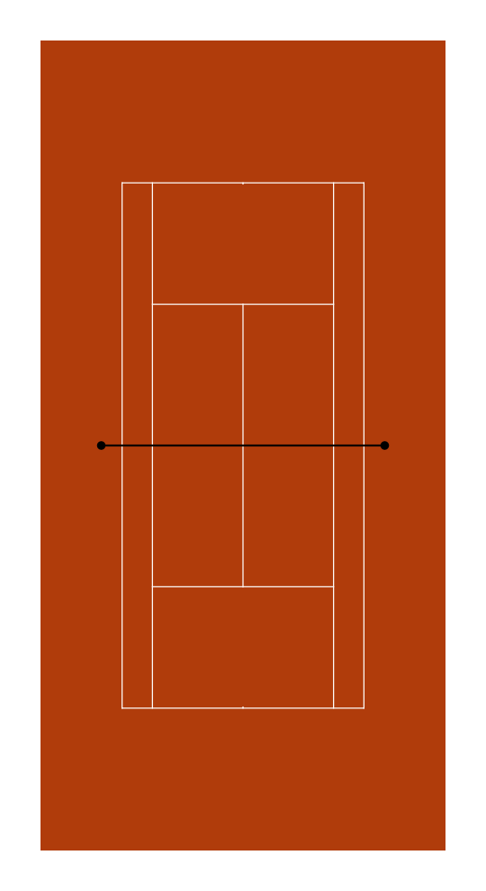
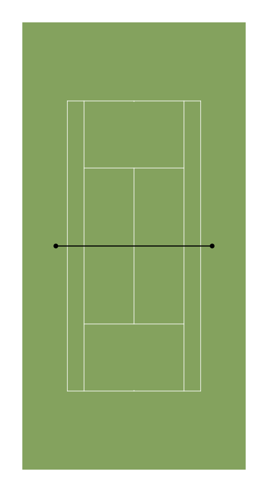
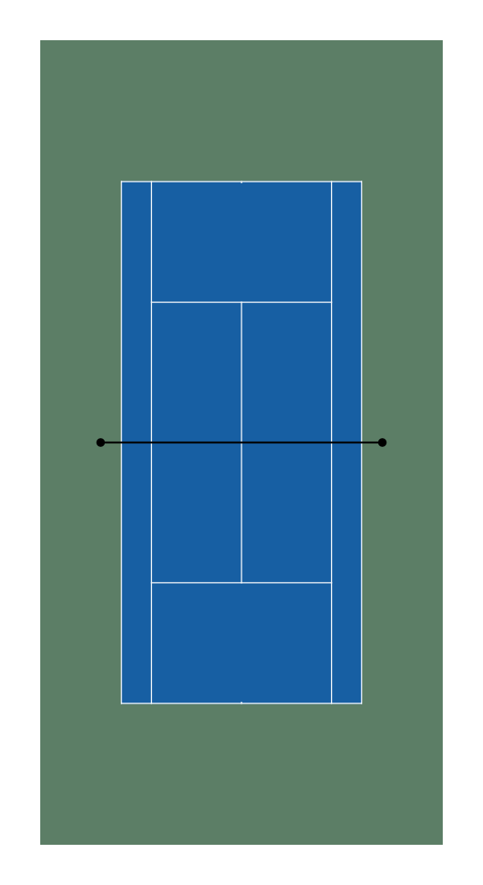

# PlotTennisCourt
An R function that draws a tennis court to scale (ITF dimensions) with `ggplot2`, in any colours you like.

## Usage

```r
source("plot_tennis_court.R")
plot_tennis_court(court_colour = "#5f819a", boundary_colour = "#508dba")
```

It returns a ggplot object, so you can add layers such as ball-landing positions in metres, with the origin at the centre of the net and the court running along the y axis. `court_colour` fills the court inside the doubles lines; `boundary_colour` fills the run-off area. Both accept any R colour name or hex code. Requires `ggplot2` (3.4.0 or later) only.

All lines are 5 cm wide and lie inside the dimensions they mark: a 23.77 m × 10.97 m doubles court, 8.23 m singles sidelines, service lines 6.40 m from the net, a 10 cm centre mark, and net posts 0.914 m outside the doubles sidelines.

## Contents
- `plot_tennis_court.R`: R script containing the function to plot a tennis court
- `PlotTennisCourt.Rproj`: R project file for the PlotTennisCourt project.
- `README.md`: This file providing an overview of the repository.
- `images`: Folder containing images of the plots that the function generates

## Example Plots
`plot_tennis_court(court_colour = "#5f819a", boundary_colour = "#508dba")` 


`plot_tennis_court(court_colour = "#b03c0b", boundary_colour = "#b03c0b")` 


`plot_tennis_court(court_colour = "#84a25e", boundary_colour = "#84a25e")` 


`plot_tennis_court(court_colour = "#175fa3", boundary_colour = "#5c7e66")` 


