# PlotTennisCourt
An R function that draws a tennis court to scale (ITF dimensions) with `ggplot2`, in any colours you like.

## Usage

```r
source("plot_tennis_court.R")
plot_tennis_court(court_colour = "#5f819a", boundary_colour = "#508dba")
```

It returns a ggplot object, so you can add layers such as ball-landing positions in metres, with the origin at the centre of the net and the court running along the y axis. `court_colour` fills the court inside the doubles lines; `boundary_colour` fills the run-off area. Both accept any R colour name or hex code. Requires `ggplot2` (3.4.0 or later) only.

| Function | What it draws |
|---|---|
| `plot_tennis_court(court_colour, boundary_colour, surface = "hard", half = FALSE, orientation = "vertical", singles_sticks = FALSE)` | The court. `surface` is a colour preset (`"hard"`, `"clay"`, `"grass"`) used for any colour you don't give; `half = TRUE` shows only the far half (y > 0); `orientation = "horizontal"` runs the court along x (swap your data's x and y to match); `singles_sticks = TRUE` marks the sticks 0.914 m outside each singles sideline |
| `tennis_serve_zones()` | Data frame of the six serve zones: each far service box split into wide / body / T thirds (1.37 m each) |
| `tennis_serve_zone_of(x, y)` | Which zone each bounce landed in, or `"Fault"` |
| `tennis_serve_map(data, x, y, colour)` | Serve bounces on the far half court, zones shaded by their share of serves in, faults as crosses |
| `tennis_court_side(max_height = 4, height_scale = 2)` | The court side-on for ball trajectories: net 0.914 m at the centre strap and 1.07 m at the posts |

Serve data assumes the server is at the near baseline (y < 0), so serves land at y > 0. The deuce box is on the receiver's right, which is −x. The side view's x axis is the distance along the court from the net (the same as y on the top-down court) and its y axis is height. At true scale that view is a 9:1 strip, so heights are stretched by `height_scale`, and the plot says so.

All lines are 5 cm wide and lie inside the dimensions they mark: a 23.77 m × 10.97 m doubles court, 8.23 m singles sidelines, service lines 6.40 m from the net, a 10 cm centre mark, and net posts 0.914 m outside the doubles sidelines. The net is 0.914 m high at the centre strap and 1.07 m at the posts.

## Contents
- `plot_tennis_court.R`: R script containing the functions to plot a tennis court, serve maps and the side view
- `examples.R`: regenerates every image in `images/` (serves and ball flights are simulated)
- `PlotTennisCourt.Rproj`: R project file for the PlotTennisCourt project.
- `README.md`: This file providing an overview of the repository.
- `images`: Folder containing images of the plots that the function generates

## Example Plots
`plot_tennis_court(court_colour = "#5f819a", boundary_colour = "#508dba")` 


`plot_tennis_court(court_colour = "#b03c0b", boundary_colour = "#b03c0b")` 


`plot_tennis_court(court_colour = "#84a25e", boundary_colour = "#84a25e")` 


`plot_tennis_court(court_colour = "#175fa3", boundary_colour = "#5c7e66")` 


`plot_tennis_court(surface = "grass", half = TRUE, singles_sticks = TRUE)`
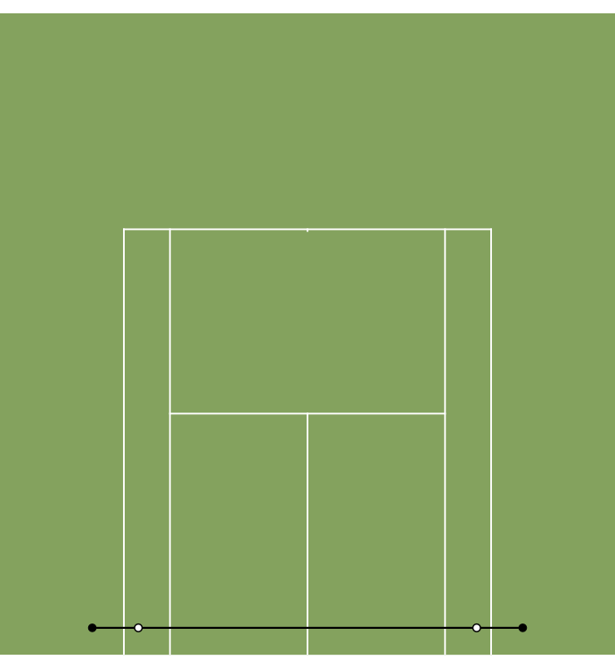

`plot_tennis_court(surface = "clay", orientation = "horizontal")`


`tennis_serve_map(serves, colour = "serve")` (simulated serves)
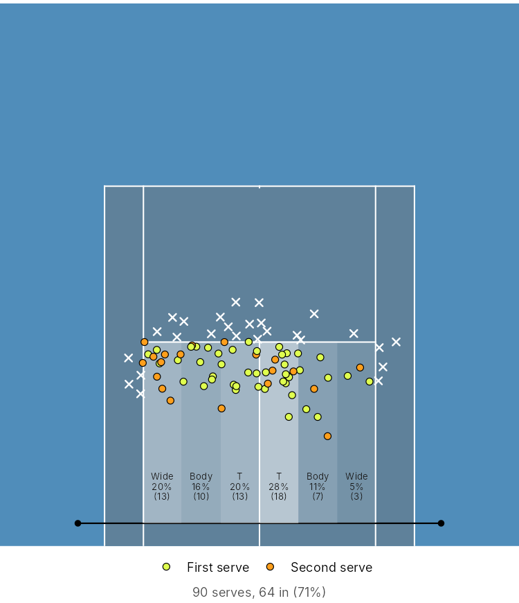

`tennis_court_side(max_height = 3) + geom_path(data = flights, aes(x, height, colour = shot))` (illustrative drag-free ball flights, not tracking data)
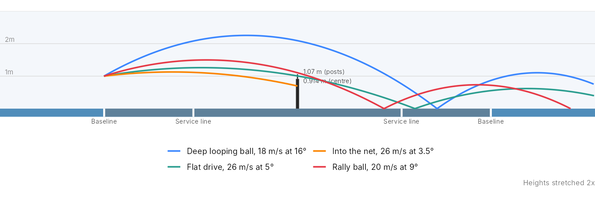

## Gallery

### Surface presets and half courts

`plot_tennis_court(surface = "hard", half = TRUE)`, `surface = "clay"` and `surface = "grass"` (with singles sticks):

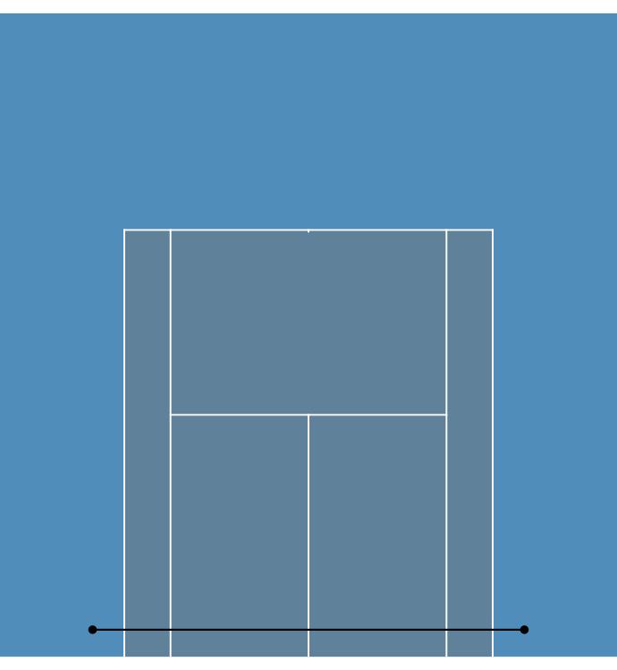 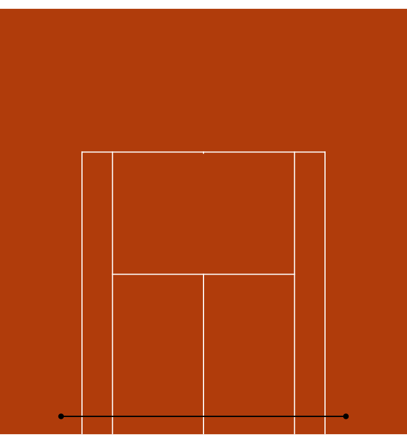 

### Horizontal courts

`orientation = "horizontal"` on grass with singles sticks, and as a half court:

 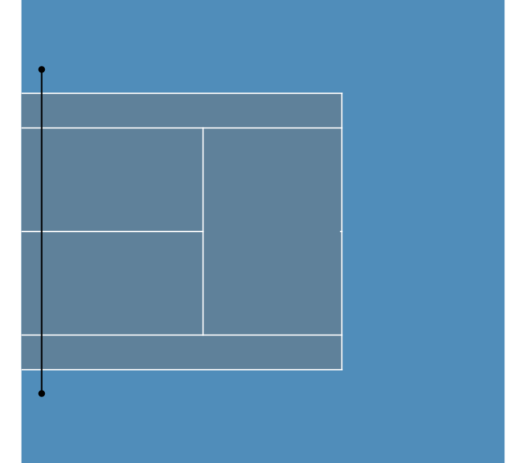

### Any colours

The four schemes above plus `plot_tennis_court(court_colour = "#3B3F8C", boundary_colour = "#2E7D5B")`:

    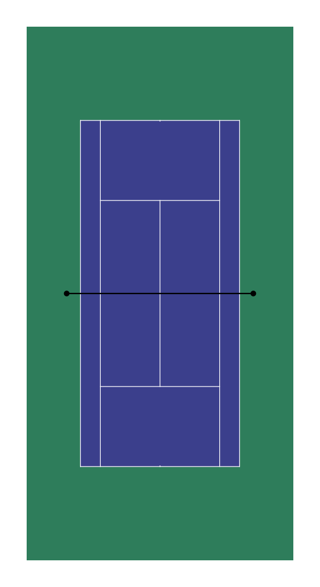

### Serve maps

Without a colour column, `tennis_serve_map(serves)`, and on clay, `tennis_serve_map(serves, surface = "clay")`:

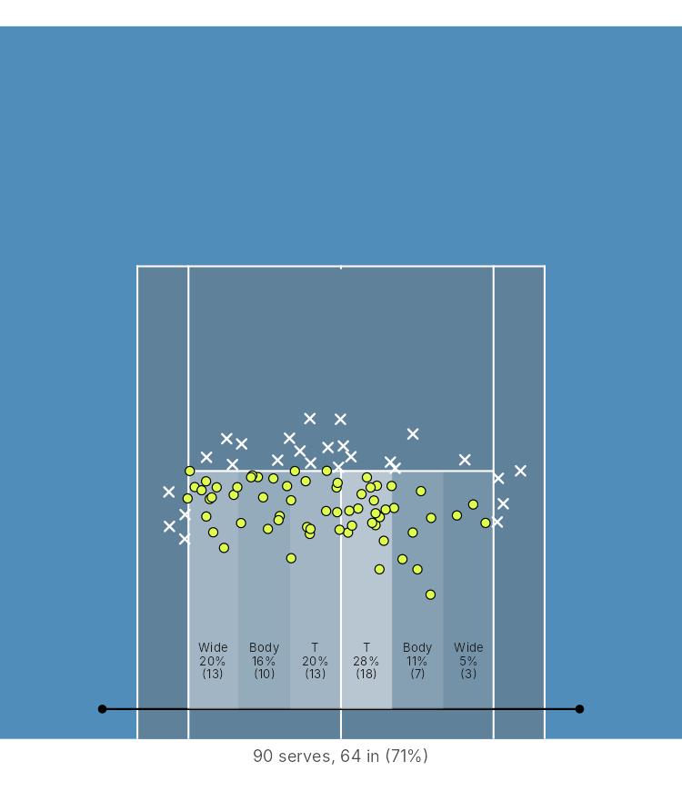 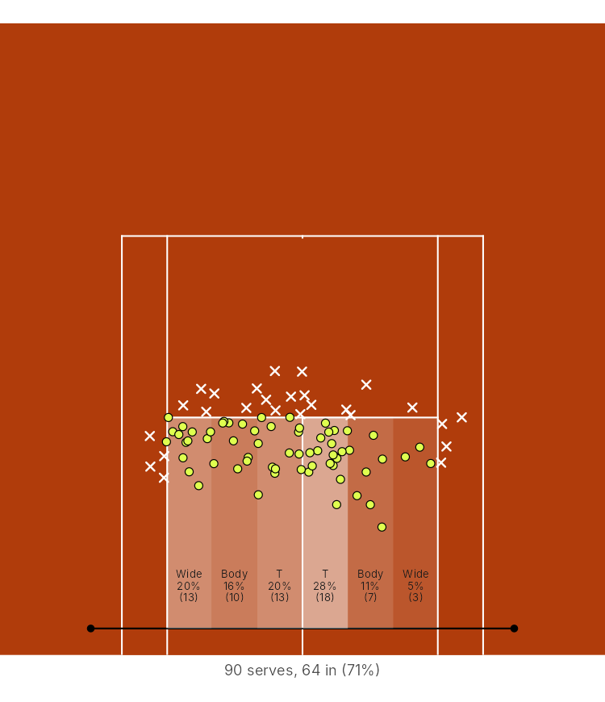

### Side view scale

At true scale (`height_scale = 1`) the court is a 9:1 strip and every flight looks flat, which is why the default stretches heights 2× and says so on the plot:

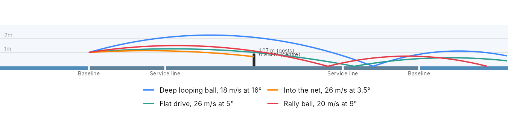

The same flights on grass, `tennis_court_side(max_height = 3, surface = "grass")`:

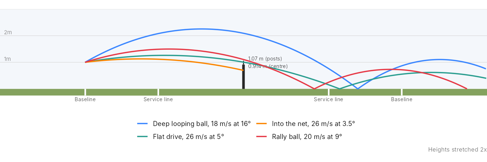
